# Rapport du scraper : taux d'obtention par champ

Généré le 2026-11-26 par `api/scripts/scrape_report.py` sur 40 pages enregistrées (`api/tests/scraper/fixtures/corpus.json`). Un champ est réussi quand la valeur extraite est présente et égale à la valeur relevée à la main sur la page (`scrape_report_rules.py`). « Avant » est le parser de `main` avant cette branche, « après » celui de cette branche.

Temps d'analyse du corpus (parser seul, HTML déjà téléchargé) : avant 55.9 s, après 35.9 s.

## 1. Par champ

| Champ | Avant | Après | Écart |
|---|---|---|---|
| title | 55.0 % | 90.0 % | +35.0 |
| price | 77.5 % | 100.0 % | +22.5 |
| old_price | 90.0 % | 97.5 % | +7.5 |
| currency | 75.0 % | 100.0 % | +25.0 |
| description | 35.0 % | 95.0 % | +60.0 |
| images>=1 | 100.0 % | 100.0 % | +0.0 |
| images main | 100.0 % | 100.0 % | +0.0 |
| images gallery | 30.0 % | 85.0 % | +55.0 |
| brand | 80.0 % | 87.5 % | +7.5 |
| availability | 70.0 % | 87.5 % | +17.5 |

```mermaid
xychart-beta
    title "Réussite par champ (% des pages)"
    x-axis ["title", "price", "old_price", "currency", "description", "images>=1", "images main", "images gallery", "brand", "availability"]
    y-axis "% pages" 0 --> 100
    bar [55.0, 77.5, 90.0, 75.0, 35.0, 100.0, 100.0, 30.0, 80.0, 70.0]
    bar [90.0, 100.0, 97.5, 100.0, 95.0, 100.0, 100.0, 85.0, 87.5, 87.5]
```

Séries, dans l'ordre : avant, après

## 2. Par page (% des 10 champs obtenus)

| Page | Avant | Après |
|---|---|---|
| aliexpress_test_file | 100.0 % | 100.0 % |
| generic_jsonld | 100.0 % | 100.0 % |
| amazon_like | 90.0 % | 100.0 % |
| robot_check | 100.0 % | 100.0 % |
| microdata | 100.0 % | 100.0 % |
| amazon_real_B0CZ762XQ3 | 70.0 % | 100.0 % |
| amazon_com_B00FLYWNYQ | 70.0 % | 100.0 % |
| amazon_com_B00NTCH52W | 60.0 % | 100.0 % |
| amazon_com_B072QRN7HR | 60.0 % | 100.0 % |
| amazon_com_B0798DVT68 | 70.0 % | 100.0 % |
| amazon_com_B07FZ8S74R | 60.0 % | 100.0 % |
| amazon_com_B07RZ74VLR | 60.0 % | 100.0 % |
| amazon_com_B08KT2Z93D | 60.0 % | 100.0 % |
| amazon_com_B0B2RM68G2 | 50.0 % | 100.0 % |
| amazon_com_B0BSHF7WHW | 70.0 % | 100.0 % |
| amazon_com_B0CHWRXH8B | 70.0 % | 100.0 % |
| amazon_com_B0CYJBB2JQ | 60.0 % | 100.0 % |
| amazon_com_B0DGPSZVW3 | 60.0 % | 100.0 % |
| amazon_de_B07SSWRQZR | 60.0 % | 100.0 % |
| amazon_de_B08C5DR9GR | 60.0 % | 100.0 % |
| amazon_de_B09JC6Q14S | 60.0 % | 100.0 % |
| amazon_de_B0CKZ4GW25 | 60.0 % | 100.0 % |
| amazon_de_B0CZ762XQ3 | 40.0 % | 100.0 % |
| amazon_fr_B072QRN7HR | 80.0 % | 90.0 % |
| amazon_fr_B077B7HZ2V | 40.0 % | 90.0 % |
| amazon_fr_B09G6M8JLK | 70.0 % | 100.0 % |
| amazon_fr_B0C3BC4QG2 | 70.0 % | 100.0 % |
| amazon_fr_B0CJ5FPMN3 | 70.0 % | 100.0 % |
| amazon_fr_B0CZ762XQ3_pw | 60.0 % | 100.0 % |
| amazon_fr_B0DK4Y2YP3 | 70.0 % | 100.0 % |
| amazon_fr_interstitial | 90.0 % | 90.0 % |
| apple_ipad_air | 70.0 % | 80.0 % |
| bellroy_note_sleeve | 70.0 % | 70.0 % |
| dyson_v15 | 80.0 % | 80.0 % |
| ikea_ektorp | 90.0 % | 90.0 % |
| ldlc_PB00432397 | 100.0 % | 90.0 % |
| lush_intergalactic | 90.0 % | 90.0 % |
| nike_IX6375 | 60.0 % | 60.0 % |
| philips_EP2231 | 70.0 % | 70.0 % |
| thalia_A1078332034 | 80.0 % | 70.0 % |

```mermaid
xychart-beta
    title "Champs obtenus par page (%)"
    x-axis ["aliexpress_test_file", "generic_jsonld", "amazon_like", "robot_check", "microdata", "amazon_real_B0CZ762XQ3", "amazon_com_B00FLYWNYQ", "amazon_com_B00NTCH52W", "amazon_com_B072QRN7HR", "amazon_com_B0798DVT68", "amazon_com_B07FZ8S74R", "amazon_com_B07RZ74VLR", "amazon_com_B08KT2Z93D", "amazon_com_B0B2RM68G2", "amazon_com_B0BSHF7WHW", "amazon_com_B0CHWRXH8B", "amazon_com_B0CYJBB2JQ", "amazon_com_B0DGPSZVW3", "amazon_de_B07SSWRQZR", "amazon_de_B08C5DR9GR", "amazon_de_B09JC6Q14S", "amazon_de_B0CKZ4GW25", "amazon_de_B0CZ762XQ3", "amazon_fr_B072QRN7HR", "amazon_fr_B077B7HZ2V", "amazon_fr_B09G6M8JLK", "amazon_fr_B0C3BC4QG2", "amazon_fr_B0CJ5FPMN3", "amazon_fr_B0CZ762XQ3_pw", "amazon_fr_B0DK4Y2YP3", "amazon_fr_interstitial", "apple_ipad_air", "bellroy_note_sleeve", "dyson_v15", "ikea_ektorp", "ldlc_PB00432397", "lush_intergalactic", "nike_IX6375", "philips_EP2231", "thalia_A1078332034"]
    y-axis "% champs" 0 --> 100
    bar [100.0, 100.0, 90.0, 100.0, 100.0, 70.0, 70.0, 60.0, 60.0, 70.0, 60.0, 60.0, 60.0, 50.0, 70.0, 70.0, 60.0, 60.0, 60.0, 60.0, 60.0, 60.0, 40.0, 80.0, 40.0, 70.0, 70.0, 70.0, 60.0, 70.0, 90.0, 70.0, 70.0, 80.0, 90.0, 100.0, 90.0, 60.0, 70.0, 80.0]
    bar [100.0, 100.0, 100.0, 100.0, 100.0, 100.0, 100.0, 100.0, 100.0, 100.0, 100.0, 100.0, 100.0, 100.0, 100.0, 100.0, 100.0, 100.0, 100.0, 100.0, 100.0, 100.0, 100.0, 90.0, 90.0, 100.0, 100.0, 100.0, 100.0, 100.0, 90.0, 80.0, 70.0, 80.0, 90.0, 90.0, 90.0, 60.0, 70.0, 70.0]
```

Séries, dans l'ordre : avant, après

## 3. Un article représentatif : `amazon_real_B0CZ762XQ3`

Pour chaque champ, 100 % = obtenu et exact, 0 % = absent ou faux.

```mermaid
xychart-beta
    title "amazon_real_B0CZ762XQ3 : réussite par champ"
    x-axis ["title", "price", "old_price", "currency", "description", "images>=1", "images main", "images gallery", "brand", "availability"]
    y-axis "%" 0 --> 100
    bar [100.0, 0.0, 100.0, 100.0, 0.0, 100.0, 100.0, 0.0, 100.0, 100.0]
    bar [100.0, 100.0, 100.0, 100.0, 100.0, 100.0, 100.0, 100.0, 100.0, 100.0]
```

Séries, dans l'ordre : avant, après

## Limites

- Le corpus est biaisé vers Amazon (24 pages sur 40) ; les pages amazon.fr et amazon.de ont été récupérées par la stratégie Playwright du scraper, car HTTPX reçoit un interstitiel depuis ce réseau (gardé comme page `amazon_fr_interstitial`).
- La vérité (« relevée à la main ») suit ce qu'un lecteur voit sur la page : prix de la boîte d'achat, puces « À propos de cet article », photos du bloc image. Une description ne compte que si elle commence comme celle de la page.
- Le temps d'analyse est mesuré sur une machine chargée : indicatif, pas un benchmark.
